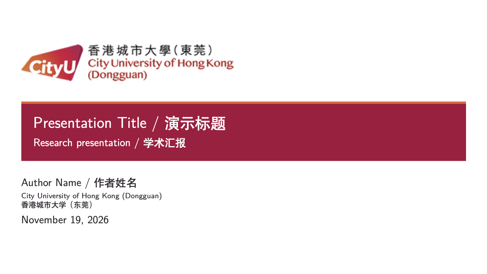

# City University of Hong Kong (Dongguan) Beamer Template

香港城市大学（东莞）学术演示模板 · XeLaTeX · 中英文 · 16:9



以用户提供的学校标识为视觉参考，采用酒红、红色及橙色，统一封面、章节页、页眉页脚、目录及内容块。**这是社区维护的非官方模板，未经学校官方认证或背书。** This is a community-maintained template, not an official university release.

学校中英文名称参照[学校官网](https://www.cityu-dg.edu.cn/)。配色为本模板的设计选择，不声明其为学校正式视觉规范。

## Quick start / 使用方法

1. 下载或克隆本仓库，打开 `main.tex`。
2. 修改 `\title`、`\author`、`\institute` 和正文。
3. 使用 **XeLaTeX** 编译，或在 Overleaf 上传源文件并将编译器设为 XeLaTeX。

安装 TeX Live / MacTeX 后，在仓库目录运行：

```sh
latexmk -xelatex -synctex=1 -interaction=nonstopmode -halt-on-error -outdir=build main.tex
```

若没有 latexmk，可先创建 build 目录，再编译两次：

```sh
mkdir -p build
xelatex -output-directory=build main.tex
xelatex -output-directory=build main.tex
```

PDF 输出到 `build/main.pdf`。VS Code 用户需安装 LaTeX Workshop 并配置自己的 XeLaTeX；本仓库不包含维护者的本机绝对路径或工作区设置。主文件含 `xeCJK`，请勿使用 pdfLaTeX。

## Files / 文件说明

- `main.tex`：可直接修改的中英文演示示例，含目录、列表、内容块、公式与表格。
- `beamerthemeCityUDG.sty`：统一主题，使用 `\usetheme{CityUDG}` 加载。
- `figures/logo-sm.png`：用户提供的学校标识，保持原始比例。
- `preview/`：编译后的示例 PDF 与封面预览。
- `CHANGELOG.md`：版本变更与验证记录。
- `NOTICE.md`：素材来源和项目身份说明。

最小使用文件为 `main.tex`、`beamerthemeCityUDG.sty` 和 `figures/logo-sm.png`。主题依赖 LaTeX Beamer；示例还使用 xeCJK、mathtools 和 TeX Live 提供的 Fandol 字体，不依赖 macOS 专有字体。

## Customize / 自定义

主题颜色在 `.sty` 中的 `DGRed`、`DGBurgundy`、`DGOrange` 定义；页眉 logo、页脚元信息和标题页也在该文件中统一调整。`\title[短标题]{完整标题}` 与 `\author[短姓名]{完整姓名}` 的短版本用于页脚。主文件默认宽屏，可调整 `aspectratio=169`。

示例表格中的数据为演示数据。模板是在原 CityU Beamer 项目基础上的视觉重构；来源与权利说明见 [NOTICE.md](NOTICE.md)。
